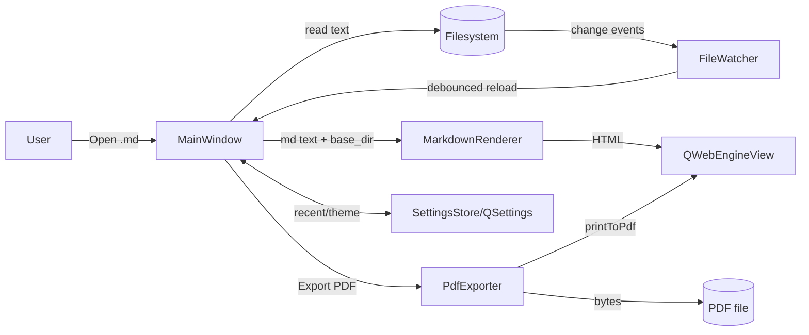

# Requirements

### Overview & Goals
Build a lightweight cross-platform desktop Markdown reader in Python using **PyQt6** that renders `.md` files as styled HTML and can export/print the rendered preview to **PDF** with high visual fidelity.

The project starts from an essentially empty scaffold (`main.py` with a placeholder `print_hi` and an empty `requirements.txt`), so this plan defines the full initial architecture.

### Scope
**In scope**
- Open a single `.md` file via File > Open, drag-and-drop, or CLI argument.
- Convert Markdown to HTML using a Python Markdown engine with extensions (tables, fenced code, TOC, syntax highlighting).
- Render HTML preview inside a `QWebEngineView` with a bundled CSS theme (light + dark).
- Print / Export the preview to PDF via `QWebEnginePage.printToPdf()`.
- Live reload when the source file changes on disk (via `QFileSystemWatcher`).
- Recent files list persisted with `QSettings`.

**Out of scope (initial release)**
- Full WYSIWYG Markdown editing (viewer-first; optional plain-text edit pane may come later).
- Multi-document tabs, plugin system, cloud sync.
- Custom Markdown dialects beyond common GFM-style extensions.

### User Stories
- As a reader, I want to open any `.md` file and see a nicely formatted preview so I can read documentation comfortably.
- As a user, I want to export the current preview to a PDF so I can share or archive it.
- As a user, I want to switch between light and dark themes so the app matches my environment.
- As a user, I want the preview to auto-refresh when the file changes so I can keep the reader open while editing elsewhere.

### Functional Requirements
- **Open file**: File menu, `Ctrl+O`, drag-and-drop, and `python main.py <path>`.
- **Preview**: renders headings, lists, tables, blockquotes, images (relative paths resolved against the file's directory), fenced code with Pygments highlighting, and inline HTML.
- **Export to PDF**: File > Export as PDF (`Ctrl+Shift+P`) → file dialog → writes PDF using a print-specific CSS (A4, sensible margins, page-break hints).
- **Print**: File > Print (`Ctrl+P`) opens the system print dialog via `QPrintDialog` and prints the web view.
- **Themes**: View > Theme > Light/Dark toggles the preview stylesheet.
- **Recent files**: last 10 files listed under File > Recent.

### Non-Functional Requirements
- Startup < 1s on a typical laptop; render a 200 KB Markdown file in < 500 ms.
- Cross-platform: Windows, macOS, Linux (PyQt6 + PyQt6-WebEngine wheels).
- No network access required at runtime; all assets (CSS, Pygments styles) bundled.

# Technical Design

### Current Implementation
The repository currently contains only a placeholder `main.py` and an empty `requirements.txt`. There is no existing UI, module structure, or dependency baseline, so this design establishes them.

### Key Decisions
- **UI framework: PyQt6** — modern, actively maintained, native look on all platforms; provides `QWebEngineView` which is essential for high-fidelity HTML→PDF.
- **HTML renderer: `QWebEngineView`** (not `QTextBrowser`) — Chromium-backed, supports modern CSS/JS and, crucially, exposes `QWebEnginePage.printToPdf()` for pixel-perfect PDF export matching the preview.
- **Markdown engine: `markdown-it-py`** with plugins (`mdit-py-plugins`) — CommonMark-compliant, GFM tables/tasklists, fast, easy to extend. `Pygments` provides syntax highlighting via HTML class output.
- **Styling: two CSS files** — `screen.css` (theme-aware, light/dark) and `print.css` (A4, page-break rules, monochrome-friendly). Loaded via `<link>` tags in the generated HTML.
- **PDF export path: `printToPdf`** on the underlying `QWebEnginePage` with a `QPageLayout` for size/margins. Avoids external tools like `wkhtmltopdf` — one dependency stack, consistent rendering.
- **File watching: `QFileSystemWatcher`** — triggers a debounced re-render on external changes.
- **Settings persistence: `QSettings`** — recent files, last theme, window geometry.
- **Packaging: `PyInstaller`** (later) — single-file distributable per platform.

### Proposed Changes
Introduce a small MVC-ish layout under a new `markdown_reader/` package:

- **`app.py`** – `QApplication` bootstrap, CLI arg parsing, theme loading.
- **`ui/main_window.py`** – `MainWindow(QMainWindow)` with menu bar, toolbar, `QWebEngineView` central widget, status bar, drag-and-drop handling.
- **`ui/actions.py`** – `QAction` factory (open, print, export PDF, theme toggle, recent files).
- **`core/renderer.py`** – `MarkdownRenderer` wrapping `markdown-it-py` + Pygments; `render(md_text, base_dir, theme) -> html`.
- **`core/pdf_exporter.py`** – `PdfExporter` that takes a `QWebEnginePage`, applies print CSS, calls `printToPdf` with a chosen `QPageLayout`, and writes bytes to disk.
- **`core/file_watcher.py`** – wraps `QFileSystemWatcher` with debouncing (`QTimer.singleShot`).
- **`core/settings.py`** – thin wrapper around `QSettings` for recent files and theme.
- **`assets/`** – `screen-light.css`, `screen-dark.css`, `print.css`, `pygments-light.css`, `pygments-dark.css`.
- **`main.py`** – becomes a thin entrypoint calling `markdown_reader.app.main()`.

`requirements.txt` gains: `PyQt6`, `PyQt6-WebEngine`, `markdown-it-py`, `mdit-py-plugins`, `Pygments`.

### Data Models / Contracts
```python

# core/renderer.py

class MarkdownRenderer:
    def __init__(self, theme: str = "light") -> None: ...
    def render(self, md_text: str, base_dir: Path) -> str:
        """Return a full HTML document (with <head> linking screen+print CSS)."""

# core/pdf_exporter.py

class PdfExporter:
    def export(self,
               page: QWebEnginePage,
               output_path: Path,
               page_layout: QPageLayout | None = None) -> None:
        """Async: calls page.printToPdf(output_path, layout); emits `finished`."""

# ui/main_window.py

class MainWindow(QMainWindow):
    def open_file(self, path: Path) -> None: ...
    def export_pdf(self) -> None: ...
    def print_document(self) -> None: ...
    def set_theme(self, theme: Literal["light", "dark"]) -> None: ...
```

HTML skeleton produced by the renderer:
```html
<!doctype html>
<html><head>
  <meta charset="utf-8">
  <base href="file:///{base_dir}/">
  <link rel="stylesheet" href="qrc:/assets/screen-{theme}.css">
  <link rel="stylesheet" href="qrc:/assets/pygments-{theme}.css">
  <link rel="stylesheet" media="print" href="qrc:/assets/print.css">
</head><body class="markdown-body">{rendered_html}</body></html>
```

### Components
- **MainWindow** – hosts the `QWebEngineView` and wires menus/toolbar actions.
- **MarkdownRenderer** – pure function-style, no Qt deps → easy to unit test.
- **PdfExporter** – isolates all `printToPdf` quirks (async callback, page layout).
- **FileWatcher** – emits `fileChanged` after debounce so `MainWindow` re-renders.
- **SettingsStore** – recent files, chosen theme, last window geometry.

### File Structure
```
MarkdownReader/
├── main.py                       # thin entrypoint
├── requirements.txt              # PyQt6, PyQt6-WebEngine, markdown-it-py, mdit-py-plugins, Pygments
└── markdown_reader/
    ├── __init__.py
    ├── app.py
    ├── core/
    │   ├── __init__.py
    │   ├── renderer.py
    │   ├── pdf_exporter.py
    │   ├── file_watcher.py
    │   └── settings.py
    ├── ui/
    │   ├── __init__.py
    │   ├── main_window.py
    │   └── actions.py
    └── assets/
        ├── screen-light.css
        ├── screen-dark.css
        ├── print.css
        ├── pygments-light.css
        └── pygments-dark.css
```

### Architecture Diagram


### Risks
- **`QWebEngineView` async PDF**: `printToPdf` is asynchronous; export logic must handle the callback and errors (e.g., disk full, path locked).
- **Relative image paths**: must set a proper `<base href>` or load via `setHtml(html, baseUrl=QUrl.fromLocalFile(...))` so images resolve.
- **Bundle size**: PyQt6-WebEngine pulls in Chromium (~150 MB). Acceptable for a desktop app but note for packaging.
- **Print CSS fidelity**: page breaks in long code blocks/tables need `page-break-inside: avoid` rules; verify with representative documents.

# Delivery Steps

### ✓ Step 1: Bootstrap PyQt6 app shell and dependencies
A runnable empty PyQt6 window launches from `main.py` with the project structure and dependencies in place.

- Populate `requirements.txt` with `PyQt6`, `PyQt6-WebEngine`, `markdown-it-py`, `mdit-py-plugins`, `Pygments`.
- Create the `markdown_reader/` package with `app.py`, `ui/main_window.py`, `core/`, and `assets/` folders.
- Implement `app.main()` that constructs `QApplication`, instantiates `MainWindow`, parses an optional CLI file path, and runs the event loop.
- Reduce `main.py` to `from markdown_reader.app import main; main()`.
- `MainWindow` starts with a menu bar (File, View, Help) and an empty `QWebEngineView` as central widget.

### ✓ Step 2: Implement Markdown-to-HTML rendering pipeline
Opening a `.md` file displays a styled HTML preview in the web view.

- Implement `core/renderer.py` `MarkdownRenderer` using `markdown-it-py` with `mdit-py-plugins` (tables, tasklists, footnotes, anchors) and Pygments highlighter.
- Build a full HTML document with `<base href>` pointing to the file's directory so relative images resolve.
- Add `assets/screen-light.css`, `screen-dark.css`, and Pygments CSS; load via `QWebEngineView.setHtml(html, baseUrl)`.
- Wire File > Open (`Ctrl+O`), drag-and-drop, and CLI arg to `MainWindow.open_file(path)` which reads the file and calls the renderer.
- Show the file name in the window title and a status-bar message.

### ✓ Step 3: Add PDF export and print support
The user can export the current preview to PDF and send it to the system printer, matching the on-screen layout.

- Implement `core/pdf_exporter.py` `PdfExporter.export(page, output_path, layout)` using `QWebEnginePage.printToPdf` with a `QPageLayout` (A4, ~15 mm margins) and a `pdfPrintingFinished` callback for success/error reporting.
- Add `assets/print.css` with `@page` size/margins and `page-break-inside: avoid` rules for code blocks, tables, and figures; link it with `media="print"`.
- Add File > Export as PDF (`Ctrl+Shift+P`) opening a `QFileDialog.getSaveFileName` and invoking the exporter; show progress in the status bar and a completion message.
- Add File > Print (`Ctrl+P`) using `QPrinter` + `QPrintDialog` and `QWebEngineView.print()`.
- Disable both actions when no document is loaded.

### ✓ Step 4: Add themes, live reload, and recent files
Quality-of-life features: theme switching, auto-refresh on external edits, and quick access to recent files.

- Implement `core/file_watcher.py` wrapping `QFileSystemWatcher` with a `QTimer`-based debounce (~200 ms); connect to `MainWindow` to re-render on change.
- Add View > Theme > Light/Dark toggle that re-renders with the chosen stylesheet.
- Implement `core/settings.py` on top of `QSettings` to persist recent files (max 10), selected theme, and window geometry across launches.
- Add a File > Recent submenu dynamically populated from `SettingsStore`.
- Validate end-to-end scenarios: open sample docs with code blocks, tables, and images; export PDFs and confirm images, syntax highlighting, and page breaks look correct in both themes.